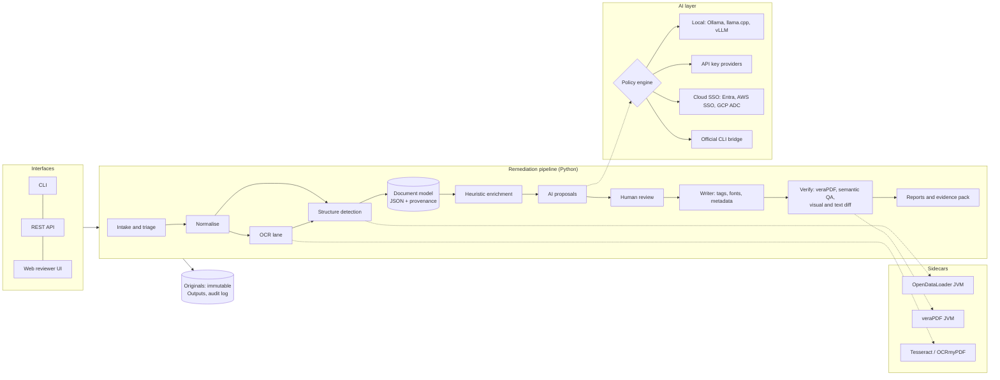

# PDF Remediation: Plan of Action

Version 1.0, 2026-10-09. Status: proposed, for review.

Supporting research (read alongside this plan):

| Doc | Content |
|---|---|
| [`research/01-source-document-review.md`](research/01-source-document-review.md) | What the three supplied documents get right and wrong |
| [`research/02-competitive-landscape.md`](research/02-competitive-landscape.md) | iAccessible, Adobe, CommonLook, PREP, Equidox, axes4, PDFix, open-source projects, published accuracy evidence |
| [`research/03-standards-and-regulations.md`](research/03-standards-and-regulations.md) | PDF/UA-1/2, Matterhorn, WCAG mapping, Section 508, Title II (2026 extension), HHS 504, exceptions |
| [`research/04-open-source-stack-and-licensing.md`](research/04-open-source-stack-and-licensing.md) | Library selection, licence policy, supply-chain controls |
| [`research/05-ai-integration-and-government-constraints.md`](research/05-ai-integration-and-government-constraints.md) | Local/API/OAuth/CLI access modes, provider terms, government AI rules, policy profiles |
| [`../spikes/001-tagging-feasibility/`](../spikes/001-tagging-feasibility/) | Reproducible experiment: pikepdf tagging, OpenDataLoader auto-tag, veraPDF validation |

---

## 0. Implementation status (v0.1, updated 2026-10-10)

A working prototype is in `src/pdf_remediation/` (see the README for usage). Against the phases below:

| Area | Built | Not yet built |
|---|---|---|
| Inputs | Multiple files, folders (recursive), zip archives, links to PDFs, links to pages (same-site PDF discovery), SSRF guard | Site crawler beyond one page, scanner inventory import |
| Phase 1 core | Intake checks, normaliser, built-in tagger, OpenDataLoader adapter, keep/repair/re-tag existing tags (alt text carried over), finisher, veraPDF sidecar with a checksum-verified installer (`pdfrem install-engines`), 20 semantic QA rules, rendering and text gates, HTML/JSON/CSV reports, CLI, install scripts | Persistent veraPDF process, document-model JSON schema as a public contract |
| Phase 2 hard content | Link and form-field tagging, ToUnicode repair (glyph names and ActualText), ActualText preservation, Python OCR (RapidOCR default, Tesseract optional) run only on pages without text, invisible text layer that follows page rotation, built-in table tagging (ruled grids with ColSpan/RowSpan and multi-row headers; borderless aligned tables with prose guards; "possible table" warnings) | Content re-marking engine (WP 2.2), row headers, nested and multi-page tables, OCR deskew and clean-up, OCR of scanned regions on pages that also have text, word-level OCR review, font embedding |
| Phase 3 AI | OpenAI-compatible adapter (local servers), local-only policy, untrusted-data fencing, per-call audit, review-before-write | Native cloud adapters, Entra/AWS SSO/GCP ADC sign-in, CLI bridge, policy profiles as signed files, model evaluation |
| Phase 4 UI | Accessible web app (axe-core: 0 violations), live job progress, figure review with alt text and decorative marking, re-validation, zip download | Reading-order, heading and table editors, screen-reader preview, multi-user sign-in and roles |
| Phase 5 | Dockerfile (not yet built in CI), CI workflow with licence gate | Windows installer, air-gapped bundle, SBOM, signed releases, pilots |

Measured on 6 real-world PDFs available in the build environment (including the three source documents supplied for this plan): all 6 pass veraPDF PDF/UA-1 machine checks after remediation with both engines, with rendering and extracted text unchanged. Before the fixes found by that sweep (ActualText being stripped, invalid Unicode maps, over-detected headings), 4 of 6 failed. Six files is a smoke test, not the evaluation corpus required by gate G0.

Changes on 2026-10-10:

- **OCR uses RapidOCR, not OCRmyPDF.** RapidOCR is Apache-2.0, its models ship inside the wheel, and it needs no Ghostscript (AGPL) or system packages. This removes risk R11 for the default install. Tesseract stays available as an optional engine.
- **OCR'd documents use the built-in engine in `auto` mode.** This follows a measurement: OpenDataLoader tagged the scan image as a Figure and changed the OCR text, so the text gate failed.
- **Table tagging measured on synthetic fixtures.** On four test tables, the built-in engine was correct on all four. OpenDataLoader missed the borderless table and tagged two sub-headings as data cells. Four synthetic tables do not establish which engine is better on real documents. That comparison belongs in the G0 evaluation corpus.

## 1. Executive summary

**Goal.** An open-source (Apache-2.0), local-first PDF remediation application that organisations, especially government and education bodies, can run on their own machines or servers to turn inaccessible PDFs into PDF/UA-1 documents that meet WCAG 2.x AA. AI assistance is optional and policy-controlled, and can use local models, API keys, cloud sign-in (OAuth/SSO), or an official vendor CLI where the vendor's terms allow.

**Why this can win.** The market splits into cloud platforms that charge per page or seat (PREP, CommonLook web, iAccessible e-508, Adobe API) and desktop editors that are manual and Windows-bound (Acrobat, axesPDF, PAC for checking). Nobody offers an open, auditable, on-premises pipeline that combines (a) modern auto-tagging, (b) transparent validation, (c) semantic QA that catches what validators miss, and (d) an efficient, accessible human review workstation, with AI that an agency can actually approve. The evidence that (c) and (d) matter is strong:

- In our spike, a deliberately mis-tagged file (heading and paragraph swapped, reading order reversed, alt text "image") **passes** veraPDF PDF/UA-1.
- Independent research reaches the same conclusion: checkers confirm that tags exist, not that they are correct ([arXiv 2410.03022](https://arxiv.org/pdf/2410.03022)).
- Guided remediation UX roughly doubled tag accuracy against Acrobat Pro in a CHI 2025 study (PAVE 2.0: 80.1% against 42.0% for experienced users).

**Feasibility.** Spike 001 shows that the core write path works in Python with permissive licences:

- pikepdf alone produced a file that passes all PDF/UA-1 machine checks.
- OpenDataLoader PDF (Apache-2.0) auto-tagged a two-column document with headings, a list, a table (with header scopes), a figure, and artifacts, locally and with no AI.
- Its output was then brought to a single remaining failure by a small "finisher". That failure was a font defect in the source file, which tagging cannot fix.

Two non-Python components are deliberately accepted: veraPDF (Java) for validation, and the OpenDataLoader core (Java).

**Scope of 1.0** (about 8 months with the team in section 9; range 7 to 11 months):

- Batch and single-document remediation for born-digital and scanned PDFs: tagging, reading order, tables, lists, figures, links, forms, bookmarks, metadata, fonts where safely fixable.
- Validation: veraPDF plus our semantic QA, mapped to Matterhorn and WCAG.
- An accessible web reviewer workstation.
- AI layer with six policy profiles.
- Title II backlog triage.
- Docker, Windows, and air-gapped distributions.
- SBOM, signed releases, and an OpenACR for the tool itself.

**Out of scope for 1.0** (Phase 6): PDF/UA-2 and WTPDF output, MathML, Office source remediation, HTML alternatives, LMS/CMS connectors, OpenAI "Sign in with ChatGPT".

---

## 2. Requirements

### 2.1 Functional

| ID | Requirement | Source |
|---|---|---|
| F1 | Remediate untagged born-digital PDFs to PDF/UA-1 | Section 508 504.2.2, market need |
| F2 | Repair or replace bad existing tags, choosing between "repair tree" and "strip and retag" | Common real-world input |
| F3 | OCR scanned pages, then tag. Low OCR confidence routes to a human. | Title II, 508 |
| F4 | Tables: header detection, `Scope`, `Headers`/`ID` for complex tables, row/column spans | WCAG 1.3.1, Matterhorn CP 15 |
| F5 | Figures: alt text, decorative to artifact, captions, long descriptions | WCAG 1.1.1, Matterhorn CP 13 |
| F6 | Lists, headings (levels), TOC, footnotes, headers/footers as artifacts | WCAG 1.3.1, 2.4.6 |
| F7 | Links and annotations tagged, with `Contents` | WCAG 2.4.4, 4.1.2, Matterhorn CP 28 |
| F8 | AcroForm fields tagged with `TU` and tab order. XFA detected and routed to "return to source". | WCAG 3.3.2, 4.1.2 |
| F9 | Document-level: title, `DisplayDocTitle`, `Lang`, per-span `Lang`, XMP `pdfuaid`, `MarkInfo`, `/Tabs /S`, bookmarks | Spike 001, WCAG 2.4.2, 3.1.1, 3.1.2 |
| F10 | Font checks: embedding, ToUnicode coverage, glyph completeness; safe repairs; otherwise "return to source" | Spike 001 finding |
| F11 | Validation: veraPDF (UA-1, optionally PDF/A), semantic QA, visual diff, text diff | Spike 001 finding |
| F12 | Human verification checklist built from Matterhorn's human-judgment failure conditions | Matterhorn 1.1 |
| F13 | Reports: per document and per batch, in HTML (accessible), JSON, and CSV; mapping to Matterhorn checkpoints and WCAG SC; evidence pack | Procurement, OCR complaints |
| F14 | Triage: lanes (auto, assisted, expert, return-to-source) and Title II exception recommendation with a logged human decision | Rule text, cost |
| F15 | AI proposals for alt text, decorative classification, titles, heading/order/table review, and a QA second reader; never auto-applied in public-facing lanes | User requirement, government constraints |
| F16 | AI access: local models, API keys, cloud OAuth/SSO, official CLI bridge (policy-gated) | User requirement |
| F17 | Interfaces: CLI, Python API, REST API, web UI; folder-watch batch | Enterprise use |
| F18 | Inventory import (CSV/JSON of URLs or files) and an optional crawler for site PDF discovery | Parity with iAccessible-style scanners |

### 2.2 Non-functional

| ID | Requirement |
|---|---|
| N1 | **Local-first:** with AI disabled or local-only, no network egress at all. Verified by a test that runs the pipeline in a container with no network. |
| N2 | **Rendering fidelity:** tagging must not change appearance. Before and after renders must be pixel-identical (tolerance only for anti-aliasing, SSIM ≥ 0.999). Any change (for example from font repair) needs explicit human approval. |
| N3 | **No text loss:** extracted text before and after must match, apart from intended OCR additions and artifact marking. |
| N4 | **Accessible UI:** WCAG 2.2 AA, Section 508 (including 504 authoring-tool rules), every editing operation available by keyboard and screen reader. |
| N5 | **Auditability:** append-only log of every automated change, AI call, and human decision. |
| N6 | **Licence hygiene:** Apache-2.0 core, with copyleft and restricted components isolated (see the licensing doc). |
| N7 | **Supply-chain security:** hash-pinned dependencies, SBOM, signed releases, offline install. |
| N8 | **Scale:** single node processes at least 10,000 pages/hour in the auto lane without AI on 8 cores. This is a hypothesis to measure in Phase 1, not a promise. Horizontal workers for more. |
| N9 | **Platforms:** Linux and Windows first-class. macOS for developers. Python 3.11 to 3.13. |
| N10 | **Honest claims:** the product never states "compliant" from machine checks alone (section 5.5). |

---

## 3. Key decisions

Each becomes an ADR in `docs/adr/` during Phase 0.

| # | Decision | Rationale | Alternatives rejected |
|---|---|---|---|
| D1 | **PDF/UA-1 first. PDF/UA-2/WTPDF in Phase 6.** | 508 references UA-1. Spike showed UA-2 needs a separate writer path (PDF 2.0 namespaces, `pdfuaid:rev`). | Dual target from day one (doubles writer complexity before any value ships) |
| D2 | **pikepdf** as the writer, **pypdfium2** as the renderer | Permissive licences. Proven in spike. | PyMuPDF (AGPL), commercial SDKs |
| D3 | **OpenDataLoader** as the default structure engine; **Docling** as the second engine for complex tables and scans; Adobe and PDFix as optional adapters | Best local, permissive option found. Spike showed good structure. | marker/surya as core (weights licence threshold), Adobe API as core (cloud and cost) |
| D4 | **ODL tagged output becomes the base. Our engine edits at the tree level in Phase 1. Content-level re-marking (splitting or merging marked content) arrives in Phase 2.** | Content-stream re-marking is the riskiest component. Tree-level edits (role, order, nesting, attributes, alt, artifacts) cover most corrections and deliver value earlier. | Writing our own full tagger first |
| D5 | **veraPDF** as validator, run as a sidecar (MPL option) | Reference implementation. Supports UA-1, UA-2, WTPDF. | PAC (Windows GUI, not scriptable) |
| D6 | Accept a **Java runtime** dependency | Needed by D3 and D5. No Python equivalent. | Pure Python (would drop validation quality) |
| D7 | Own a **document model** (JSON schema) between detection and writing | Decouples engines from the writer. Stores confidence and provenance. Enables review and undo. | Editing PDFs directly in each step |
| D8 | **AI proposes, people approve.** Policy engine enforces data boundaries before any egress. | Government constraints. Model error rates. | Auto-apply AI output |
| D9 | **Own thin AI adapters** (OpenAI-compatible HTTP plus native SDK extras). LiteLLM optional. | Supply-chain risk (LiteLLM compromise, March 2026), smaller dependency surface | LiteLLM as the core gateway |
| D10 | **CLI bridge invokes official vendor CLIs only.** Never reuse their tokens. Off by default, locked in government profiles. | Anthropic and Google prohibit third-party reuse of consumer OAuth tokens | Token reuse (gets users' accounts banned) |
| D11 | **One web UI** (served on localhost for single users, or from a server), with an optional pywebview desktop shell | One UI to make accessible and audit | Separate Qt desktop app |
| D12 | **Policy profiles** (signed YAML) hold standards, compliance dates, AI allowlists, and lane thresholds | Title II and HHS dates moved in 2026. Different jurisdictions. | Hard-coded rules |
| D13 | Front end: **server-rendered HTML + HTMX + USWDS**, with focused TypeScript modules for the viewer, table editor, and order editor | Accessibility control, fewer dependencies, Python-centric team | Full SPA (revisit if editor complexity demands it) |

---

## 4. Architecture



### 4.1 Package layout

```
src/pdf_remediation/
  intake/       # hashing, type sniffing, encryption and signature detection, triage features, lanes
  normalize/    # qpdf repair, content-stream normalisation (no-op text blocks, inline images)
  detect/       # adapters: opendataloader, docling, existing-tags importer, adobe (opt), pdfix (opt)
  model/        # document model, JSON schema, provenance, diff and undo
  enrich/       # heuristics: heading levels, lists, captions, header/footer, footnotes, TOC, Lang
  ocr/          # OCRmyPDF and engine plugins, confidence capture
  ai/           # providers, auth methods, policy engine, tasks, prompts (versioned), audit
  write/        # tree ops, content marking (phase 2), artifacts, annotations, forms, fonts, metadata
  verify/       # verapdf sidecar, matterhorn map, wcag map, semantic QA rules, visual and text diff
  report/       # HTML, JSON, CSV, evidence pack, batch summaries
  triage/       # Title II exception recommendation and decision records
  server/       # FastAPI app, jobs (RQ), auth (OIDC/SAML), RBAC
  ui/           # templates, USWDS assets, pdf.js integration, TS modules
  profiles/     # shipped signed policy profiles
  cli.py
```

### 4.2 Document model (core contract)

```jsonc
{
  "schema": "pdfrem/document/1",
  "source": {"sha256": "...", "pages": 12, "pdf_version": "1.7", "producer": "...", "tagged": false,
             "signed": false, "encrypted": false, "forms": "none|acroform|xfa", "scanned_pages": [3,4]},
  "profile": "state-local-gov@2026.10",
  "lane": "assisted",
  "nodes": [
    {"id": "n17", "role": "H2", "page": 1, "bbox": [72,600,540,620],
     "content": [{"kind": "mcid", "page": 1, "mcid": 4}],
     "children": [], "attrs": {}, "alt": null, "lang": null,
     "confidence": 0.93,
     "provenance": [{"by": "engine:opendataloader@2.5.12", "at": "..."},
                    {"by": "rule:heading-level-by-font@1", "change": "H3->H2"}],
     "review": {"status": "accepted", "by": "user:jdoe", "at": "..."}}
  ],
  "issues": [{"id": "i3", "rule": "sqa.alt.placeholder", "node": "n40", "severity": "high",
              "matterhorn": ["13-004"], "wcag": ["1.1.1"], "status": "open"}],
  "decisions": [{"type": "title2-exception", "value": "not-eligible", "by": "user:..."}]
}
```

### 4.3 Pipeline stages and their contracts

| Stage | Input → output | Key logic | Failure handling |
|---|---|---|---|
| Intake | file → `source` facts, lane | Encryption (needs password or rejected), signatures (warn: changes invalidate them; offer re-sign), XFA, JavaScript, size/page limits, tagged-tree quality score | Reject with reason. Original is stored immutably. |
| Normalise | PDF → PDF | qpdf repair, remove no-op text blocks, preserve rendering | Visual diff gate |
| OCR | PDF → PDF with text layer + per-word confidence | OCRmyPDF `--output-type pdf`, skip pages that already have text | Low confidence → expert lane |
| Detect | PDF → document model | ODL tagged output + JSON; existing tags import; Docling for flagged tables | Engine disagreement → flag |
| Enrich | model → model | Heading levels from font statistics, repeated header/footer → artifacts, caption ↔ figure, list repair, bookmarks, language spans | Every change is recorded as provenance |
| AI | model → proposals | Policy check → provider → JSON schema output | Provider failure → continue without AI |
| Review | proposals → decisions | Lane rules decide what needs a human | Unreviewed required items block "verified" status |
| Write | model → PDF | Tree ops (Phase 1), content re-marking (Phase 2), finisher, fonts | Visual and text diff gates; rollback |
| Verify | PDF → results | veraPDF UA-1, semantic QA rules, visual and text diff, reading-order preview | Failures → issues back to review |
| Report | all → HTML, JSON, CSV, evidence zip | Matterhorn and WCAG mapping, three-part status (section 5.5) | n/a |

### 4.4 Semantic QA rules (v1 set, beyond veraPDF)

Each rule has an ID, the Matterhorn and WCAG references it maps to, a severity, and a test fixture that proves it fires on spike-001's `wrong_embed.pdf` or similar.

1. `sqa.heading.font-inversion`: an H(n) set in a smaller font than nearby P text, or P text larger than every heading.
2. `sqa.heading.skip`: heading levels skip (H1 → H3) without justification. This is a warning, since skipping is allowed by PDF/UA but often wrong.
3. `sqa.heading.none`: a document longer than N pages has no headings.
4. `sqa.order.geometry`: reading order deviates strongly from the column-aware geometric order (Kendall tau below a threshold).
5. `sqa.order.split-sentence`: a sentence is split across non-adjacent nodes.
6. `sqa.alt.placeholder`: alt text matches placeholder or filename patterns ("image", "image 1", "IMG_1234.jpg", "picture", empty).
7. `sqa.alt.redundant`: alt text starts with "image of" or "picture of", or duplicates the caption.
8. `sqa.alt.length`: too short for a complex figure (a chart with axes detected), or too long for alt text (suggest a long description instead).
9. `sqa.figure.text-inside`: OCR finds substantial text inside a figure (image of text, WCAG 1.4.5).
10. `sqa.table.no-headers`: table with no TH, or TH without Scope in a multi-row header table.
11. `sqa.table.layout`: a table used for layout (one column, or cells containing paragraphs) → suggest re-role.
12. `sqa.list.unmarked`: paragraph sequences starting with bullet glyphs or numbering that are not tagged L/LI.
13. `sqa.link.text`: link text is "click here", "here", "more", or a bare URL.
14. `sqa.lang.mismatch`: detected language differs from `Lang` for spans above a size threshold.
15. `sqa.artifact.content-loss`: text marked as artifact that is not repeated on other pages and is not a page number.
16. `sqa.contrast.estimate`: text over a solid fill below 4.5:1 (3:1 for large text). Over images or gradients → "needs review".
17. `sqa.ocr.confidence`: page OCR confidence below threshold.
18. `sqa.title.generic`: the title is a filename or a generic value such as "Untitled" or "Microsoft Word - ...".

### 4.5 The CLI (first public interface)

```
pdfrem triage   <paths...>  --profile state-local-gov  --out inventory.csv
pdfrem remediate <paths...> --profile ... --lane auto|assisted --ai off|local|<provider-id> --out outdir/
pdfrem validate <paths...>  --flavour ua1 [--pdfa 2a] --format html|json
pdfrem report   <job-id>    --format html|json|csv --evidence-pack
pdfrem serve    [--host 127.0.0.1] [--port 8765]          # local web UI
pdfrem models   list|pull|verify                            # local model manifest and hashes
pdfrem ai       providers|test|login <provider>            # SSO and device-code flows
```

---

## 5. Cross-cutting design

### 5.1 Lanes

| Lane | Typical input | Human involvement | AI auto-accept |
|---|---|---|---|
| Auto | Born-digital, simple layout, embedded fonts, no figures or simple decorative ones, internal or archival use | Spot check (sampling rate set by profile) | Only where the profile allows (enterprise or internal) |
| Assisted | Figures, tables, multi-column, public-facing | Review AI proposals and flagged issues; checklist | No |
| Expert | Scans with low OCR confidence, complex tables, forms, math, damaged files | Full manual workflow | No |
| Return to source | XFA, broken fonts that cannot be repaired, encrypted without password, documents better re-exported from the original | Report explains why and how to fix at the source | n/a |

### 5.2 Rendering and text safety gates

Each write step is followed by the following checks:

1. Render all pages with pypdfium2 at 100 dpi and compare with the original (pixel/SSIM).
2. Compare extracted text (normalised) with the original.
3. Run veraPDF on the result.

A failure of (1) or (2) rolls back the step and raises an issue. This guards against the most damaging failure: a "remediated" PDF that looks or reads differently from the original.

### 5.3 Security

- Treat input PDFs as hostile: parse in a worker process with resource limits (memory, time, pages); no JavaScript execution; sandboxed container option.
- AI prompt-injection defences (see the AI doc, section 3).
- Server mode: OIDC/SAML SSO, RBAC (remediator, reviewer, approver, admin, auditor), CSRF protection, encryption at rest (customer-managed keys when on S3), TLS.
- Secrets in keyring or vault, never in the database.

### 5.4 Audit and evidence

An append-only event log (with an optional hash chain) records: file ingested, each automated change (rule or engine + version), each AI call (provider, model, prompt version, input hash, output, tokens, latency), each human decision, and each validation run. The evidence pack is a zip of the original, the output, the validation reports, the issue list with resolutions, the AI proposals with their reviewers, and the checklist.

### 5.5 Status vocabulary (honest claims)

Every document carries a three-part status, displayed verbatim in reports:

1. **Machine validation:** veraPDF PDF/UA-1 *pass/fail* (with rule list).
2. **Semantic QA:** *n open flags*.
3. **Human verification:** *complete by {name} on {date} against checklist v{x}* or *not done*.

Only when all three are complete may a report say "Meets PDF/UA-1 and WCAG 2.1 AA document requirements, as verified by {name} on {date}". The tool never prints "compliant" or "certified" on its own authority.

### 5.6 Policy profiles

Signed YAML containing: target standards (UA-1, WCAG version and level), legal references with source URL and last-verified date, compliance dates, lane thresholds, AI provider allowlist and data boundaries, auto-accept rules, CLI-bridge status, retention settings. Profiles shipped: `local-only`, `federal-high`, `education-ferpa`, `state-local-gov`, `enterprise`, `personal`. Details are in the AI doc, section 4.

---

## 6. Phased plan

Durations assume the team in section 9. Phases overlap. Each phase ends with a **gate**: the phase is not complete until every gate criterion is met or explicitly waived in a recorded decision. Numeric targets marked *(H)* are hypotheses to be re-set once the Phase 0 baseline exists. Setting targets before measuring would be guessing.

### Phase 0: Foundations (weeks 0 to 3)

| WP | Tasks | Output |
|---|---|---|
| 0.1 Repo and CI | `src/` layout, `uv` lock with hashes, ruff, mypy, pytest, pre-commit; CI matrix (Linux and Windows, Python 3.11 to 3.13, JRE 17/21); licence gate; CycloneDX SBOM; CodeQL | Green CI on an empty package |
| 0.2 ADRs | Write D1 to D13 as ADRs | `docs/adr/0001..0013` |
| 0.3 Corpus | Collect PDF Association PDF/UA reference files and Matterhorn reference suite (check licence); veraPDF corpus; public-domain U.S. federal PDFs across categories; state and education PDFs whose licence permits redistribution; synthetic generator extended from spike 001 with known ground truth. Categories: untagged born-digital, badly tagged, scanned, forms, table-heavy, multi-column, multilingual, math, damaged. | ≥200 documents, ≥50 with gold structure annotations (2 annotators, adjudicated) |
| 0.4 Evaluation harness | Metrics: veraPDF pass and rule counts; role precision/recall/F1 per tag type; reading-order Kendall tau; table header accuracy; heading-level accuracy; alt-text presence and lint flags; visual diff; text diff; pages/hour | `pdfrem-eval` command and an HTML scoreboard |
| 0.5 Baseline | Run (a) ODL alone, (b) ODL + spike finisher, (c) ODL hybrid (docling) over the corpus | Baseline report; set the *(H)* targets |
| 0.6 Legal and naming | Licence policy review, project name and trademark search, contributor licence (DCO) | Signed-off policy |

**Gate G0:** CI green on Linux and Windows; corpus and gold set in place; baseline published; targets for G1 to G3 fixed from data.

### Phase 1: Core engine MVP, CLI (weeks 3 to 11)

| WP | Tasks |
|---|---|
| 1.1 Intake and triage | Feature extraction (version, producer, tagged, tree-quality score, fonts, scanned pages, forms, JS, signatures, encryption); lane assignment rules from the profile |
| 1.2 Document model | Pydantic models + JSON schema; importers for ODL JSON/tagged PDF and for existing struct trees; diff and undo |
| 1.3 Normaliser | qpdf repair; no-op text block removal (spike 001); unused resource pruning; safety gates |
| 1.4 ODL adapter | Long-lived JVM per worker (avoid start-up cost per file), batch mode, timeouts, version pinning |
| 1.5 Tree-level writer | Ops: set role, move or reorder, wrap or unwrap, merge siblings, set attributes (Scope, Headers/ID, ListNumbering), set Alt/ActualText/E/Lang, convert node to artifact (when it maps to whole MCIDs), ParentTree rebuild, RoleMap |
| 1.6 Finisher | MarkInfo, Lang, Title (from H1 or user), DisplayDocTitle, XMP and pdfuaid, Tabs, bookmarks from headings, PDF version handling |
| 1.7 veraPDF sidecar | Persistent process (REST or batch CLI), JSON parsing, rule → Matterhorn → WCAG mapping tables |
| 1.8 Semantic QA v1 | Rules 1 to 18 (section 4.4), each with fixtures |
| 1.9 Safety | Visual diff and text diff gates; signature and encryption handling |
| 1.10 Reports and CLI | HTML (itself accessible), JSON, CSV; the `triage`, `remediate`, `validate`, `report` commands |

**Gate G1:**

- On the born-digital untagged subset with embedded fonts: veraPDF UA-1 pass rate ≥ *(H) 90%*.
- Zero visual regressions across the corpus.
- Semantic QA flags `wrong_embed.pdf` with at least the heading-inversion, order, and alt-placeholder rules.
- 1,000-page batch completes without crash.
- Throughput measured, and N8 confirmed or re-set.

### Phase 2: Hard content (weeks 9 to 18)

| WP | Tasks | Notes |
|---|---|---|
| 2.1 OCR lane | OCRmyPDF (Tesseract) → tag; RapidOCR/PaddleOCR plugins; per-word confidence in the model | Test Ghostscript-free paths where possible |
| 2.2 Content re-marking engine | Minimal content-stream interpreter tracking CTM and text matrices to compute bounding boxes per text-showing operator; split TJ arrays at region boundaries; re-assign MCIDs; handle Form XObjects (tag inside or around), inline images, Type 3 fonts, clipping, optional content | **Highest technical risk.** Prototype in spike 002 in week 9 before committing. Fallback: route such pages to the expert lane. |
| 2.3 Tables | Docling TableFormer cross-check; multi-row/column headers; Headers/ID; spans; summary; table editor data ops | |
| 2.4 Forms | AcroForm widgets → Form struct elements + OBJR; `TU`; tab order; XFA detection → return to source | |
| 2.5 Links and annotations | Link struct elements with OBJR; `Contents`; other annotations tagged or artifacted | |
| 2.6 Fonts | Detect non-embedded fonts, missing ToUnicode, incomplete subsets; repair ToUnicode from glyph names and cmap (fontTools); embed metric-compatible substitutes (Liberation/URW) **only** with visual-diff approval; otherwise return to source | Spike 001 finding |
| 2.7 Language spans and bookmarks | Per-span `Lang` from detection; bookmarks for documents over N pages | |

**Gate G2:**

- Scanned subset: OCR'd and tagged output passes UA-1 at ≥ *(H)* rate, with low-confidence pages correctly routed.
- Table header accuracy ≥ *(H)* on the gold set.
- Forms subset: all fields have `TU` and tags.
- Spike 002 completed with a go/no-go decision recorded.

### Phase 3: AI layer (weeks 12 to 22)

| WP | Tasks |
|---|---|
| 3.1 Provider core | `ModelProvider` interface; OpenAI-compatible adapter (Ollama, llama.cpp, vLLM, LM Studio); structured JSON outputs; retries and timeouts |
| 3.2 Policy engine and audit | Profiles; data-boundary enforcement before egress; per-call audit; PII redaction option |
| 3.3 Key-based providers | OpenAI, Anthropic, Google AI Studio, Mistral, Azure OpenAI, Bedrock, Vertex |
| 3.4 SSO/OAuth | Entra ID (device code and browser), AWS SSO profiles, GCP ADC, GitHub device flow; keyring storage |
| 3.5 AI tasks | Alt text, decorative classifier, title, heading/order review, table review, QA second reader; versioned prompts; injection defences |
| 3.6 Model packaging | Local model manifest with hashes and licences; `pdfrem models pull/verify`; offline bundles |
| 3.7 Evaluation | Alt-text rating protocol (rubric for accuracy, completeness, conciseness, context fit; two raters; Cohen's kappa reported); compare at least two local models and two remote models; publish model cards; record per-task latency on CPU and GPU |
| 3.8 CLI bridge | Official CLI subprocess adapter; ToS warning; locked in government profiles |

**Gate G3:**

- With `local-only`, a network-isolated test passes (N1).
- The best local model reaches ≥ *(H)* "acceptable without edit" on alt text, as rated by humans.
- Every AI output carries provenance.
- Policy tests prove remote providers cannot run under `local-only`, `education-ferpa`, or `federal-high` unless allowlisted.

### Phase 4: Reviewer workstation UI (weeks 14 to 26)

| WP | Tasks |
|---|---|
| 4.1 UX research | Interview and observe 6 to 8 remediators, including at least 2 screen-reader users; task analysis; record pain points with Acrobat, CommonLook, PAC |
| 4.2 Shell | FastAPI + Jinja + HTMX + USWDS; job list; document view; localhost single-user mode |
| 4.3 Viewer | pdf.js page view with tag overlays and reading-order numbers; synchronized tag-tree panel; **every operation available from the tree by keyboard** (the non-visual path is first-class, not an afterthought) |
| 4.4 Queues | Alt-text queue (image, context, AI draft, accept/edit/reject); issue queue; Matterhorn human checklist per document |
| 4.5 Editors | Reading-order editor (drag plus keyboard move up/down); heading level editor; table editor (header cells, scope, spans); artifact toggle |
| 4.6 Preview | Linearised screen-reader preview from the struct tree (roles announced the way NVDA would); optional local TTS |
| 4.7 Multi-user | OIDC/SAML; RBAC; assignment; comments; approval step |
| 4.8 Accessibility of the UI | Continuous axe-core in CI for templates; manual audits each sprint; external audit before 1.0; OpenACR for the product |

**Gate G4:**

- Usability test: participants complete the standard remediation task set with SUS ≥ *(H)*.
- Tag accuracy on the test documents ≥ *(H)*, compared with Acrobat on the same documents (PAVE-style protocol).
- External accessibility audit has no open critical or serious issues.

### Phase 5: Enterprise and government readiness, 1.0 (weeks 22 to 32)

| WP | Tasks |
|---|---|
| 5.1 Packaging | Docker images (amd64/arm64) with JRE, Tesseract, veraPDF, ODL; Helm chart; **Windows installer** (embedded Python and JRE, pywebview shell), because most remediators work on Windows; air-gapped bundle (wheelhouse, images, models, checksums, signatures) |
| 5.2 Batch and integrations | Folder watch; REST API with OpenAPI; inventory import (CSV/JSON, including formats from scanners such as iAccessible or Siteimprove once confirmed); optional crawler (robots.txt, rate limits, auth support) |
| 5.3 Title II triage | Exception recommendation, decision records, backlog dashboard (counts by lane, effort estimate, deadline from profile) |
| 5.4 Security | STRIDE threat model; SAST and dependency scanning; fuzzing the parser boundary with malformed PDFs; external penetration test; hardening guide |
| 5.5 Docs and compliance kit | Admin, remediator, and AI-policy guides; OpenACR/VPAT; AI use-case template (M-25-21); data-flow diagrams; SBOM; licence inventory |
| 5.6 Pilots | 2 to 3 organisations (for example a state education agency, a university, a city). Measure minutes per page against their current tool, quality on a sample checked by an independent auditor, and defects found. |

**Gate G5 (1.0 release):**

- Pilot data shows a time-per-page improvement against the pilots' baseline with equal or better audited quality. Report the numbers whatever they are.
- All gates G0 to G4 are passed.
- Signed release with SBOM.

### Phase 6: After 1.0

PDF/UA-2 and WTPDF writer (PDF 2.0 namespaces, MathML); Office source checks (DOCX/PPTX) with return-to-author guidance; HTML alternative output; connectors (SharePoint, Google Drive, Canvas/Blackboard, Drupal/WordPress); right-to-left and CJK scripts; OpenAI "Sign in with ChatGPT" if partner approval is obtained; active-learning loop (reviewer corrections become training and evaluation data, opt-in).

---

## 7. Revisit pass: each step re-examined for what could break

This section is the result of going back over every step above and asking "how does this fail, how would we notice, and what does the plan already do about it?" Items marked **(changed)** caused a change to the plan during this review. The first table records those changes; the second covers residual risks by step.

### 7.1 Changes made to the plan during review

| # | Original assumption | What broke it | Change |
|---|---|---|---|
| R1 | Use PyMuPDF for rendering and text | AGPL-3.0 licence | pypdfium2 + pdfminer (D2) |
| R2 | veraPDF pass = success metric | Spike: semantically wrong file passes | Semantic QA, human verification, three-part status (5.5) |
| R3 | Build our own content-stream tagger first | Highest-risk component, not needed for early value | ODL base + tree edits in Phase 1; re-marking in Phase 2 behind spike 002 (D4) |
| R4 | "CLI auth" means reusing CLI login tokens | Anthropic and Google terms prohibit it; bans enforced | Official-CLI subprocess bridge, off by default (D10) |
| R5 | LiteLLM as AI gateway | PyPI compromise in March 2026; large dependency surface | Own adapters (D9) |
| R6 | Title II deadline April 2026 (from source docs) | DOJ IFR moved it to 2027/2028; HHS likewise | Dates live in profiles (D12) |
| R7 | Native desktop app | Two UIs to make accessible | One web UI + pywebview shell (D11) |
| R8 | Target PDF/UA-2 now | 508 cites UA-1; spike shows UA-2 is a different path | UA-1 first (D1) |
| R9 | "Python only" | No Python validator of veraPDF quality; ODL core is Java | Accept JRE sidecar (D6) |
| R10 | Use marker/surya for best extraction | Weights licence restricts organisations above $5M | Optional plugin only |
| R11 | OCRmyPDF default output (PDF/A via Ghostscript) | Ghostscript rewrite can alter the file and adds AGPL binaries to images | `--output-type pdf`, then our tagging; evaluate Ghostscript-free rendering paths |
| R12 | Modify PDFs freely | Digital signatures become invalid; some PDFs are legal records | Detect signatures, warn, offer re-signing (pyHanko), or route to return-to-source |
| R13 | Linux server is enough | Remediators mostly work on Windows desktops | Windows installer in Phase 5; Windows in CI from Phase 0 |
| R14 | Fixed numeric quality targets | No baseline existed; vendor numbers are not comparable | Targets set at G0 from measured baseline *(H)* |
| R15 | AI can classify Title II exceptions | Legal determination with real consequences | AI excluded; tool recommends, a named person decides |

### 7.2 Residual risks, step by step

| Step | What could break | How we would detect it | Built-in mitigation |
|---|---|---|---|
| Intake | Malicious PDFs (decompression bombs, parser exploits) | Fuzzing, resource monitors | Worker isolation, limits, no JS, updated qpdf/pdfium |
| Intake | Encrypted PDFs with owner-only restrictions | Triage flag | Respect permissions; require the owner's authorisation; log |
| Triage | Misrouting a complex document to the auto lane | Sampling audits, QA flags | Conservative thresholds; mandatory spot-check rate |
| Normalise | Removing operators that matter (for example a BT block that sets state used later) | Visual and text diff | Only remove blocks with no painting and no state used later; gate |
| OCR | Wrong language pack; handwriting; low-quality scans | Confidence scores, `sqa.ocr.confidence` | Route to expert lane; language detection before OCR |
| Detect (ODL) | Merged paragraphs in one MCID; misdetected columns; missed tables | Gold-set metrics, QA rules | Docling cross-check; Phase 2 re-marking; human review |
| Detect (ODL) | Upstream changes (open-core boundary shifts, licence change, abandonment) | Release monitoring | Pinned versions; adapter boundary; Docling as second engine; fork option under Apache-2.0 |
| Detect | Existing tags partly good, partly broken | Tree-quality score | Choose between repair and strip-and-retag per document; human can override |
| Enrich | Heading heuristics fail on stylised documents (all-caps body, coloured headings) | Gold metrics, QA flags | Confidence-weighted; AI review on low confidence; human review |
| AI | Hallucinated alt text, especially numbers in charts | Rating protocol, numeric cross-check against extracted text | Never auto-accept for public lanes; flag numbers not in source |
| AI | Prompt injection via document text | Red-team test files | Untrusted-data wrapping; schema outputs; no tools; output lint |
| AI | Local model too slow on CPU-only machines | Latency measurement in 3.7 | Async queue; small models; AI optional |
| AI | Provider terms change (as with the 2026 OAuth changes) | Terms review per release | Terms link and date per adapter; CLI bridge off by default |
| AI | Model licence violation by users | Licence shown at pull time | Manifest with licence field; government profile allowlist |
| Write | Struct tree inconsistent with content (orphan MCIDs, ParentTree errors) | veraPDF; our consistency checker | Rebuild ParentTree from scratch on every write; property tests |
| Write | Re-marking breaks rendering (q/Q nesting, clipping, marked content crossing BT boundaries) | Visual diff | Spike 002; per-page rollback; expert lane fallback |
| Write | Font substitution changes appearance | Visual diff | Human approval required; return to source by default |
| Write | Incremental save versus full rewrite breaks signatures or large-file performance | Tests on signed and large files | Signature detection; streaming saves; size limits |
| Verify | veraPDF version changes rule results | Pinned version; regression corpus | Upgrade only with a corpus diff review |
| Verify | Contrast estimate is wrong for complex backgrounds | Manual checks | Report as "needs review", never as pass |
| Report | Users read "pass" as "compliant" | Pilot feedback | Fixed status vocabulary (5.5); wording reviewed with counsel |
| UI | The tool itself is inaccessible, undermining credibility and 508 sales | axe in CI, manual and external audits | Phase 4.8; screen-reader users in UX research |
| Packaging | JRE patching burden in government environments | Customer feedback | Use the distribution JRE; document update process; SBOM lists the JRE |
| Packaging | Air-gapped model install is too large | Bundle size tracking | Tiered bundles (no-AI, small model, full) |
| Integrations | Scanner export formats differ from assumptions (e.g. iAccessible) | Trial account test | Generic CSV/JSON mapping UI instead of hard-coded formats |
| Legal | Title II exception rules misencoded | Counsel review | Recommendation only; cites rule text; human decides |
| Project | Scope creep into web scanning (Siteimprove/iAccessible territory) | Roadmap review | Discovery limited to finding PDFs; web page checking stays out of scope |
| Project | Corpus too small or unrepresentative, giving misleading metrics | Category coverage report | G0 requires category coverage; pilots add real data (with permission) |
| Project | Single-maintainer risk in key dependencies (pikepdf, ODL) | Dependency health review | Funding or sponsorship; contribute upstream; adapters allow swapping |

---

## 8. Competitive advantage against iAccessible (and how to complement it)

| Dimension | iAccessible (from vendor material) | This project |
|---|---|---|
| Deployment | Cloud (AWS / "FedRAMP servers"); no on-premises option advertised | Local, on-premises, air-gapped; cloud optional |
| Scope | Site scanning, PDF discovery, assessments, monitoring; e-508 remediation; tiered AI/human service | Remediation engine + reviewer workstation; PDF discovery and inventory import; no web-page scanning |
| AI | AI tiers (descriptions, structure); "95% compliance" by its own assessment tool | Pluggable AI with policy profiles, including local-only; every AI output reviewable and logged |
| Transparency | Proprietary scoring | Open rules, veraPDF reports, Matterhorn and WCAG mapping, published evaluation corpus and results |
| Cost | Quote-based | Free software; costs are hardware, staff time, and optional AI usage |
| Fit together | Discovery and monitoring at site level | Import its inventory, remediate locally, re-publish. Its monitoring then confirms the fix. |

The honest trade-off: iAccessible and similar services include human experts and accountability that software alone does not provide. Organisations with no remediation staff may still prefer a service. This project's target users are organisations with staff who remediate, or service providers who want an open toolchain.

---

## 9. Team, effort, and cost assumptions

**Assumed team for the 8-month 1.0:**

- 2 PDF/back-end engineers
- 1 ML/AI engineer
- 1 front-end engineer with accessibility expertise
- 1 platform/DevOps engineer (half-time from Phase 3)
- 1 accessibility lead (IAAP CPACC/WAS or DHS Trusted Tester), who owns checklists and audits
- Half-time designer
- Half-time product manager
- Paid usability participants, including screen-reader users

**Smaller team** (2 engineers + part-time accessibility lead): a usable CLI (Phase 1 + OCR) in about 4 to 5 months; 1.0 in roughly 14 to 18 months.

**External costs** (to budget, not estimated here without quotes): external accessibility audit of the UI, penetration test, legal review of licence policy and claims wording, optional trial licences for benchmarking (Adobe, PDFix, PREP, CommonLook), GPU hardware or cloud credits for the model evaluation.

These estimates are judgement based on the work-package breakdown, not measured velocity. Re-estimate at G0 and G1.

---

## 10. Success metrics (tracked from G0 onward)

| Metric | Measured how |
|---|---|
| veraPDF UA-1 pass rate per corpus category | Evaluation harness |
| Role F1, reading-order tau, table header accuracy versus gold | Evaluation harness |
| Semantic QA precision (flags that were real problems) | Reviewer outcomes |
| Alt text acceptable-without-edit rate per model | Rating protocol |
| Minutes per page, by lane | Pilot time logs, against the pilot's prior tool |
| Visual and text regressions | Must be zero |
| Human-verified documents as a share of processed documents | Audit log |
| UI accessibility defects (critical/serious) | Audits |

---

## 11. First 30 days: concrete actions

1. Approve or amend D1 to D13. Record them as ADRs.
2. Create the package skeleton and CI (WP 0.1), including the licence gate and the Windows runner.
3. Convert spike 001's finisher and empty-text-block cleanup into tested modules (`write/finisher.py`, `normalize/text_blocks.py`).
4. Stand up the veraPDF sidecar wrapper with JSON parsing and the rule → Matterhorn mapping table.
5. Start corpus collection and write the annotation guide for gold structure (WP 0.3). Recruit two annotators.
6. Build the evaluation harness skeleton and run the ODL baseline (WP 0.4, 0.5).
7. Draft the `state-local-gov` and `local-only` profiles with sourced legal references.
8. Open trial requests with iAccessible, PDFix, and Adobe to confirm export formats and benchmark terms.
9. Recruit 2 to 3 pilot organisations and agree data-sharing terms.
10. Schedule spike 002 (content re-marking) for week 9, with a written go/no-go criterion.

---

## 12. Open questions for the project owner

1. **Licensing of contributions:** DCO or CLA? (A CLA keeps open the option of dual licensing later. A DCO is simpler and more trusted by contributors.)
2. **Governance:** a single company, or a foundation home (for example OpenSSF, Linux Foundation, or the PDF Association's community programs) once there is traction?
3. **Service model:** will anyone offer hosting or human remediation services on top? This affects FedRAMP or GovRAMP plans and branding.
4. **Pilot partners:** which education or government organisations are reachable? Their document mix should shape the corpus.
5. **Department of Education claim:** the plan assumes iAccessible is widely used in education, as you reported. Confirming which offices use it, and for what (scanning or remediation), would sharpen positioning.
